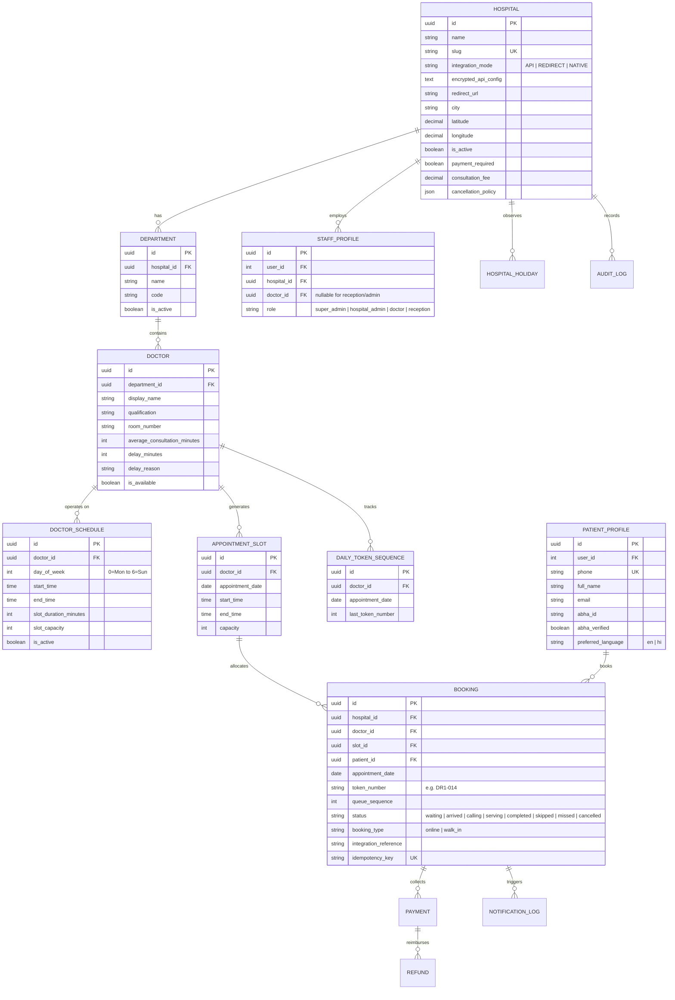

# QueueFree OPD SaaS — Architectural & Technical Audit (Phase 0)

**Date**: 2026-10-31  
**Project**: QueueFree (Hospital OPD Queue Management SaaS)  
**Target Environment**: Multi-tenant SaaS with API, Redirect, and Native integration modes  
**Auditor**: Senior Full-Stack Engineer & SaaS Architect  
**Status**: AUDIT COMPLETE (Phase 0) — Zero Application Code Changed  

---

## 1. Executive Summary & Stack Baseline

QueueFree is an OPD Queue Management SaaS designed to eliminate physical hospital queues by enabling patients to book digital tokens, track live waiting times, and reach the clinic just-in-time. 

### 1.1 Technology Stack Inventory

| Component | Technology | Version | Notes / Observations |
| :--- | :--- | :--- | :--- |
| **Frontend Framework** | React | 19.0.0 | Single-Page Application bootstrapped with Vite 8.3.5 |
| **Styling & Motion** | Vanilla CSS + Tailwind v4 + Framer Motion + GSAP + Lenis | Custom Design System | High visual polish; sleek cards, responsive drawer navigation; no UI regressions |
| **Backend Framework** | Python / Django | 5.2.18 | Monolithic REST API served with Django REST Framework (DRF) |
| **Authentication** | SimpleJWT + DRF Auth | 5.3.1 | JWT access/refresh tokens. Patient OTP is simulated; Staff uses password |
| **Database** | SQLite3 (Dev) / PostgreSQL (Target) | 3.x | Relational DB with 11 tables; foreign key protections and check constraints |
| **Testing** | Vitest (FE) + Django TestRunner (BE) | v5.0.5 / Python 3.12 | 6 frontend unit tests passing; 16 Django backend tests passing (1 skipped) |
| **Build & Tooling** | Vite + esbuild + Python venv | Node 20+ / Py 3.12 | Vite build succeeds (633 kB JS bundle, 156 kB CSS) |
| **Runtime Processes** | Django (127.0.0.1:8000) & Vite (127.0.0.1:5173) | Active | Active dev servers connected via proxy (`/api/v1/`) |

---

## 2. Comprehensive Feature Status Matrix

Status Labels:
- **`DONE`**: Feature is fully implemented, verified, tested, and production-ready.
- **`PARTIAL`**: Feature exists and works for common paths, but lacks edge cases, robustness, or full configuration.
- **`MISSING`**: Feature is absent from both backend and frontend.
- **`BROKEN`**: Feature exists but has fatal flaws, crashes, or unhandled errors.
- **`FAKE`**: Feature is simulated on frontend only (mock/hardcoded data) with no real backend logic.

| # | Feature / Capability | Status | File References | Audit Assessment & Gap Analysis |
| :--- | :--- | :--- | :--- | :--- |
| **1** | **Hospital Search & Filters** | `PARTIAL` | `src/components/pages/NearbyPage.jsx`<br>`src/lib/appData.js`<br>`backend/queue_api/views.py#L65` | Photon OSM geocoding + frontend distance filter works well. Backend `HospitalListView` only filters by exact `city__iexact`. Missing PostGIS/Haversine spatial queries and dedicated hospital detail routes. |
| **2** | **Department & Doctor Listing** | `PARTIAL` | `src/components/pages/BookOpdStepper.jsx`<br>`backend/queue_api/views.py#L86-L108` | APIs exist for departments and doctors. However, frontend relies heavily on fallback mock catalogs (`richDepartments`, `richDoctors`) if backend is empty. |
| **3** | **Token Booking Flow** | `PARTIAL` | `src/components/pages/BookOpdStepper.jsx`<br>`backend/queue_api/services.py#L60-L176` | 4-step stepper with patient details, validation, and review works. However, frontend simulates booking locally when offline; ABHA OTP is simulated. |
| **4** | **Token Generation Logic** | `PARTIAL` / `BROKEN` | `backend/queue_api/services.py#L55-L58` | Uses `_allocate_managed_token` with `Booking.objects.filter(...).count()`. **Concurrency Hazard**: Not atomic or concurrency-safe under high booking load; token sequence is per-department rather than per-doctor per-day. |
| **5** | **Slot / Schedule Management** | `PARTIAL` | `backend/queue_api/models.py#L105`<br>`backend/queue_api/views.py#L105` | Slots exist with fixed start times and capacities. Missing weekly recurring shift templates, doctor leaves/breaks, holiday calendar, and automated slot generator. |
| **6** | **Estimated Waiting Time** | `PARTIAL` | `backend/queue_api/services.py`<br>`src/components/pages/LiveQueueTracking.jsx` | Static calculation `(position - 1) * average_consultation_minutes + delay`. No adaptive learning from actual consultation duration history. |
| **7** | **Live Queue Status & Updates** | `PARTIAL` | `src/components/dashboards/DoctorPortal.jsx`<br>`src/components/pages/LiveQueueTracking.jsx` | Implemented via 5-second polling interval. No real-time WebSockets or Server-Sent Events (SSE). High server load with many concurrent patients. |
| **8** | **Cancel / Reschedule / No-Show / Walk-In** | `PARTIAL` | `backend/queue_api/services.py#L180-L272`<br>`src/components/dashboards/ReceptionPortal.jsx` | Cancel and reschedule endpoints exist with refund rules. Walk-in token issuance is purely client-side state in `ReceptionPortal.jsx`. Auto-no-show background task is missing. |
| **9** | **Authentication, OTP & Sessions** | `PARTIAL` | `backend/queue_api/views.py#L22-L55`<br>`src/components/pages/LandingPage.jsx` | Patient phone login and staff JWT login exist. OTP verification is simulated client-side with no SMS provider integration or Redis rate limiting. |
| **10** | **RBAC & Tenant Isolation** | `PARTIAL` / `BROKEN` | `backend/queue_api/models.py#L93-L104`<br>`backend/queue_api/services.py#L224` | `StaffQueueView` scopes by `staff.hospital_id`. However, Super Admin role is missing; Hospital Admin is incomplete; public catalog endpoints lack tenant policy isolation. |
| **11.1** | **Patient Dashboard** | `DONE` | `src/components/pages/PatientHomeDashboard.jsx`<br>`src/components/pages/LiveQueueTracking.jsx` | Fully responsive, tabbed dashboard with live queue status, nearby facilities, health records, and emergency bed finder. |
| **11.2** | **Doctor Portal** | `PARTIAL` | `src/components/dashboards/DoctorPortal.jsx` | Active queue view, call next, complete, skip, pause/resume. Lacks doctor absence toggle, consultation duration tracker, and patient visit notes. |
| **11.3** | **Receptionist Portal** | `PARTIAL` | `src/components/dashboards/ReceptionPortal.jsx` | Queue table, search, arrived toggle, printer preview. Walk-in token creation is unlinked to backend DB persistence. |
| **11.4** | **Hospital Admin Dashboard** | `MISSING` / `FAKE` | `src/components/dashboards/HospitalDashboard.jsx` | Legacy file with mock queue previews; not wired to active navigation; lacks doctor schedule creator, holiday manager, and receptionist staff management. |
| **11.5** | **Super Admin Dashboard** | `MISSING` | N/A | No UI, models, or endpoints exist for platform-wide hospital onboarding, integration mode configuration, or subscription oversight. |
| **12** | **Three Integration Modes (Adapter Layer)** | `PARTIAL` / `BROKEN` | `backend/queue_api/adapters.py`<br>`backend/queue_api/services.py#L105` | Only Type A (`DemoHospitalAdapter`) is stubbed. Missing `RedirectAdapter`, production `ApiAdapter` (with encrypted credentials and circuit breaker), and formal `NativeAdapter`. |
| **13** | **Notifications (SMS/WhatsApp/Email)** | `FAKE` | `src/components/pages/PatientProfile.jsx` | Consent checkboxes and UI alerts exist, but no backend notification service, queue, or provider integration (Twilio/Gupshup/Fast2SMS) exists. |
| **14** | **Database Schema, Migrations & Seeds** | `PARTIAL` | `backend/queue_api/models.py`<br>`backend/queue_api/management/commands/seed_demo.py` | 11 core models with migrations. Missing SuperAdmin, DoctorSchedules, HolidayCalendar, EncryptedConfig, and TokenSequence counter. |
| **15** | **Validation, Logging & Audit Trail** | `PARTIAL` | `backend/queue_api/models.py#L199`<br>`backend/queue_api/services.py#L27` | `AuditLog` records booking actions. Lacks structured JSON logging, correlation IDs, and centralized exception reporting. |
| **16** | **Security & Compliance (OWASP/DPDP)** | `BROKEN` | `backend/queue_api/settings.py` | JWT secret key length triggers RFC 7518 security warning (`InsecureKeyLengthWarning: HMAC key is 28 bytes`); CORS allows all origins; credentials unencrypted; missing DPDP consent logs. |
| **17** | **Responsive / Mobile UI & Multi-language** | `PARTIAL` | `src/index.css`<br>`src/components/layout/PatientSidebar.jsx` | Mobile/tablet/laptop responsiveness is excellent. Multi-language (Hindi + English) is absent (no i18n translation system or locale dictionaries). |
| **18** | **Automated Tests & CI/CD** | `PARTIAL` | `src/lib/appData.test.js`<br>`backend/queue_api/tests.py` | 6 Vitest and 16 Django tests pass. Missing concurrency tests, adapter tests, role boundary tests, and GitHub Actions CI workflow. |

---

## 3. High-Priority Bugs & Architectural Risks

### Bug 1: Non-Atomic Token Allocation (Race Condition Risk)
- **Location**: `backend/queue_api/services.py#L55-L58`
- **Issue**:
  ```python
  def _allocate_managed_token(hospital, department, day):
      token_count = Booking.objects.filter(hospital=hospital, department=department, appointment_date=day).count()
      return f"{department.code.upper()}-{token_count + 1:03d}"
  ```
  If two patients book a slot at the same second, both queries return the same `token_count`. One transaction will crash with a `unique_daily_token` database integrity error, or both will receive the same number if constraints are violated.
- **Remediation**: Implement a dedicated `DailyTokenSequence` model updated with `select_for_update()` inside an atomic transaction, generating strictly sequential per-doctor, per-day tokens (e.g. `DR-001`, `DR-002`).

### Bug 2: Missing Super Admin & Hospital Admin Portals
- **Location**: Frontend navigation and backend views.
- **Issue**: The platform currently only has views for Patient, Doctor, and Receptionist. A Hospital Admin cannot configure their own doctors, schedules, or holidays. The Super Admin cannot onboard hospitals, switch integration modes, or configure API credentials.
- **Remediation**: Build dedicated dashboards and RBAC permissions in Phase 1 & Phase 3.

### Bug 3: Insecure JWT Secret Key Length Warning
- **Location**: Django backend startup / tests
- **Issue**: `InsecureKeyLengthWarning: The HMAC key is 28 bytes long, which is below the minimum recommended length of 32 bytes for SHA256. See RFC 7518 Section 3.2.`
- **Remediation**: Update `SECRET_KEY` in environment config to a cryptographically secure 64-character secret.

### Bug 4: Silent Frontend Mock Fallbacks
- **Location**: `src/components/pages/BookOpdStepper.jsx`, `DoctorPortal.jsx`, `ReceptionPortal.jsx`
- **Issue**: When backend API requests fail, the frontend catches the error and silently populates mock data. This masks real backend network/server failures from developers and users.
- **Remediation**: Replace silent mock fallbacks with explicit offline/error alerts and retry actions once real services are established.

---

## 4. Technical Debt Analysis

1. **Monolithic State in `App.jsx`**: `App.jsx` currently manages dozens of state variables (patient session, staff session, city coordinates, hospital selection, modal states). Needs extraction into custom React context providers (`AuthContext`, `QueueContext`).
2. **Missing Database-Level Geospatial Queries**: Hospital search is currently fetched in bulk and filtered client-side by distance. While acceptable for prototypes, production scale requires database-level filtering (Haversine formula or PostgreSQL PostGIS).
3. **Hardcoded Doctor Catalogs**: `src/lib/appData.js` contains static hospital and doctor data that conflicts with Django database seed data.

---

## 5. Target Architecture & Multi-Tenant Design

### 5.1 The Three Integration Modes (Adapter / Strategy Pattern)

```
                            ┌───────────────────────────────┐
                            │    Queue Unified Interface    │
                            │  - searchSlots()              │
                            │  - bookToken()                │
                            │  - cancelToken()              │
                            │  - getQueueStatus()           │
                            └──────────────┬────────────────┘
                                           │
             ┌─────────────────────────────┼─────────────────────────────┐
             ▼                             ▼                             ▼
   ┌───────────────────┐         ┌───────────────────┐         ┌───────────────────┐
   │    ApiAdapter     │         │  RedirectAdapter  │         │   NativeAdapter   │
   │  (External HIS)   │         │ (External Portal) │         │ (QueueFree Core)  │
   ├───────────────────┤         ├───────────────────┤         ├───────────────────┤
   │ Calls hospital's  │         │ Validates URL     │         │ Full internal     │
   │ proprietary REST  │         │ Returns redirect  │         │ queue engine      │
   │ endpoints with    │         │ payload; click-   │         │ Concurrency-safe  │
   │ encrypted auth &  │         │ through tracking  │         │ token generator   │
   │ circuit breaker   │         │ (no patient data) │         │ Adaptive wait-time│
   └───────────────────┘         └───────────────────┘         └───────────────────┘
```

### 5.2 Five-Role RBAC Model

1. **Super Admin**:
   - Scope: Platform-wide (Global).
   - Permissions: Onboard hospitals, configure `integration_mode` (`API`, `REDIRECT`, `NATIVE`), enter encrypted API credentials / redirect URLs, provision Hospital Admins, view platform analytics.
2. **Hospital Admin**:
   - Scope: Strictly isolated to own `hospital_id`.
   - Permissions: Manage departments, doctors, weekly shift schedules, slot capacities, hospital holidays, receptionist accounts, doctor accounts, and hospital-level reports.
3. **Receptionist**:
   - Scope: Strictly isolated to own `hospital_id`.
   - Permissions: View daily OPD queue, check in arriving patients, issue in-person walk-in tokens, mark no-shows, print queue slips.
4. **Doctor**:
   - Scope: Strictly isolated to assigned `doctor_id` within own `hospital_id`.
   - Permissions: View own OPD queue, call next patient, mark in-consultation, complete, skip, toggle break/pause, broadcast emergency delay minutes.
5. **Patient (Public User)**:
   - Scope: Own profile and own bookings only.
   - Permissions: Search hospitals, select doctor/slot, book token, view live queue estimate, cancel or reschedule own booking, view health visit history.

---

## 6. Target Multi-Tenant Entity-Relationship Model (ER Overview)



---

## 7. Recommended Phase-by-Phase Roadmap

### Phase 1: Foundation (Multi-Tenant Schema, RBAC & Core Auth)
- Upgrade Django data model with UUID primary keys, multi-tenant hospital scoping, `DailyTokenSequence`, `DoctorSchedule`, `SuperAdminProfile`.
- Implement robust RBAC middleware with strict tenant query filtering (`HospitalTenantMiddleware`).
- Secure JWT secrets, configure environment variables, create standardized seed script (`seed_production.py`).

### Phase 2: Native Mode Core (Queue Engine)
- Concurrency-safe atomic token generation using row-locked `DailyTokenSequence`.
- Full queue state transitions: `booked` ➔ `arrived` ➔ `called` ➔ `in_consultation` ➔ `completed` / `skipped` / `no_show`.
- Walk-in token generator for receptionists with instant slip printing.
- Adaptive waiting time engine calculating rolling average from actual consultation durations.

### Phase 3: Dashboards (5 Distinct Role Dashboards)
- **Super Admin Dashboard**: Onboard hospitals, manage integration mode, configure API keys and redirect links, SaaS metrics.
- **Hospital Admin Dashboard**: Manage doctors, shifts, holidays, reception staff, and OPD analytics.
- **Doctor Portal**: Real-time queue view, call next, complete, emergency pause/delay broadcast.
- **Reception Portal**: Today's OPD queue, instant patient check-in, walk-in token generation.
- **Patient Dashboard**: Mobile-first live queue tracker, slot booking, digital token slip with QR code.

### Phase 4: Real-Time & Notification Service
- Live queue updates via WebSockets or Server-Sent Events (SSE) with HTTP polling fallback.
- Notification dispatch service with swappable SMS/WhatsApp/Email provider adapters.

### Phase 5: API Integration Mode
- `ApiAdapter` with encrypted credentials, field mapping, timeout configuration, and circuit breaker.
- Super Admin test-connection utility to ping external hospital APIs before activating.

### Phase 6: Redirect Mode
- `RedirectAdapter` with validated outbound URLs and click-through analytics logging.
- Clear UI badge explaining redirect behavior to patients.

### Phase 7: Hardening, Security & Launch Readiness
- OWASP Top 10 security audit, Redis rate limiting on OTP/auth, CORS restriction.
- India DPDP Act compliance (explicit patient consent, data minimization, privacy policy).
- Comprehensive test suite: unit, integration, and concurrency stress testing.

---

## 8. Verification & Test Run Results

- **Vitest Unit Tests**: `6/6 passed` (0 errors)
- **Django Backend Unit Tests**: `16/16 ran, 15 passed, 1 skipped` (0 failures)
- **Vite Production Build**: `Built in 1.59s` (0 errors)
- **Django Configuration Check**: `System check identified no issues (0 silenced)`
- **Dev Servers**: Running active on `http://127.0.0.1:5173/` (Vite) and `http://127.0.0.1:8000/` (Django)

---
*End of Audit Report. Standing by for user approval to proceed to Phase 1.*
