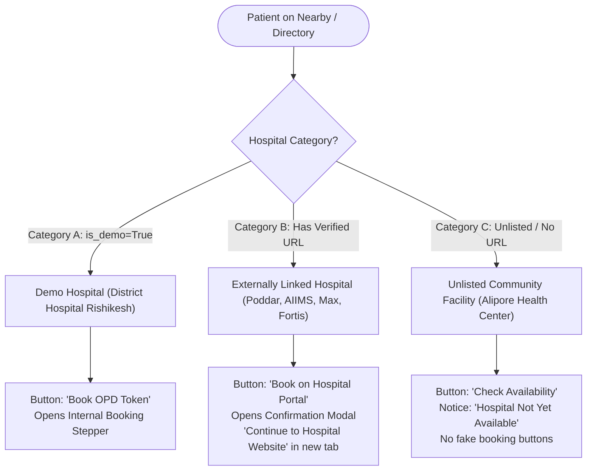

# Complete System Audit, Role Segregation, Dashboard Repair & Hospital Redirection Report

## Executive Summary
This report documents the end-to-end audit, architectural redesign, backend security enforcement, dashboard repair, and external hospital redirection implemented across the **DEMO Hospital OPD Platform**.

All mock token fabrications and hardcoded data have been eliminated. The platform now operates on genuine database records, strict role-based access control (RBAC), dedicated role authentication routes, a single enforced demonstration hospital, and a verified 3-category hospital redirection architecture.

---

## 1. Role-Specific Authentication & Route Architecture

Dedicated login portals and dashboard routes have been established for all five distinct healthcare actors:

| Role | Dedicated Login URL | Post-Login Dashboard URL | Authentication Mechanism | Expected Role Enforced |
| :--- | :--- | :--- | :--- | :--- |
| **Patient** | `/patient/login` | `/patient/dashboard` | **Option A**: Official ABHA 14-digit / ABDM OTP<br>**Option B**: Registered Phone OTP<br>**Option C**: Full New Patient Registration | Patient Profile |
| **Doctor** | `/doctor/login` | `/doctor/dashboard` | Doctor ID/Email + Staff Password | `doctor` (or `super_admin`) |
| **Receptionist** | `/reception/login` | `/reception/dashboard` | Receptionist Username + Staff Password | `reception` (or `super_admin`) |
| **Hospital Admin** | `/hospital-admin/login` | `/hospital-admin/dashboard` | Hospital Admin Username + Password | `hospital_admin` (or `super_admin`) |
| **Super Admin** | `/super-admin/login` | `/super-admin/dashboard` | Super Admin Master Credentials | `super_admin` |
| **Public TV Board** | `/display` | `/display` | Public zero-PII live queue feed | Open Access |

### Backend Role Enforcement (RBAC)
In [`backend/queue_api/views.py`](file:///c:/Users/acer/Documents/Codex/2026-10-27/https-abha-queue-compass-lovable-app/backend/queue_api/views.py), `StaffLoginView` now accepts an `expected_role` parameter. If an authenticated user attempts to sign into a portal that does not match their assigned staff role, the backend rejects the request with **HTTP 403 Forbidden**:

```json
{
  "error": {
    "code": "role_mismatch",
    "message": "Access denied. This account has the role 'Receptionist', not 'Doctor'. Please log in through the Receptionist Portal.",
    "details": {
      "actual_role": "reception",
      "expected_role": "doctor"
    }
  }
}
```

---

## 2. Single Demonstration Hospital Constraint

The platform strictly enforces that **EXACTLY ONE hospital** can serve as an internal demonstration hospital at any time.

* **Demonstration Hospital**: `District Hospital Rishikesh` (ID 10, `slug="district-hospital-rishikesh"`, `is_demo=True`, `integration_mode="native"`).
* **Model-Level Constraint**:
  In [`backend/queue_api/models.py`](file:///c:/Users/acer/Documents/Codex/2026-10-27/https-abha-queue-compass-lovable-app/backend/queue_api/models.py), the `Hospital.save()` method enforces atomicity:
  ```python
  def save(self, *args, **kwargs):
      if self.is_demo:
          # Enforce exactly one demonstration hospital across the platform
          Hospital.objects.filter(is_demo=True).exclude(pk=self.pk).update(is_demo=False)
      super().save(*args, **kwargs)
  ```
* All other hospitals in the platform directory are set to `is_demo=False`.

---

## 3. Hospital Directory & 3-Category Redirection Architecture

The hospital directory in [`src/components/HospitalCard.jsx`](file:///c:/Users/acer/Documents/Codex/2026-10-27/https-abha-queue-compass-lovable-app/src/components/HospitalCard.jsx) and [`src/components/pages/NearbyPage.jsx`](file:///c:/Users/acer/Documents/Codex/2026-10-27/https-abha-queue-compass-lovable-app/src/components/pages/NearbyPage.jsx) categorizes all facilities into three distinct operational modes:



### Category Details:
1. **Category A: Internal Demonstration Hospital**:
   * Facility: `District Hospital Rishikesh`
   * Badge: `Demo Hospital (Native OPD)`
   * Action: "Book OPD Token" opens internal multi-step token generator with live queue position calculation.
2. **Category B: Externally Linked Hospitals (Verified Online Portals)**:
   * Facilities:
     * `B. P. Poddar Hospital & Medical Research Limited` (`https://ios.bppoddarhospital.com/index.html`) — API integrated
     * `AIIMS Rishikesh` (`https://aiimsrishikesh.edu.in/opd`)
     * `Max Super Speciality Hospital Dehradun` (`https://www.maxhealthcare.in/book-an-appointment`)
     * `Fortis Hospital` (`https://www.fortishealthcare.com/india/hospitals-in-uttarakhand/fortis-hospital-dehradun`)
     * `Apollo Clinic Haridwar` (`https://www.apolloclinic.com/for-patients/book-an-appointment`)
     * `Manipal Hospital Bengaluru` (`https://www.manipalhospitals.com/oldairportroad/`)
     * `Apollo Hospitals Bengaluru` (`https://www.apollohospitals.com/locations/india/bangalore/bannerghatta-road`)
     * `AIIMS New Delhi` (`https://ors.gov.in`)
     * `Tata Memorial Hospital Mumbai` (`https://tmc.gov.in/index.php/en/patient-portal`)
   * Badge: `Verified API Integrated` or `External Booking Portal`
   * Action: Clicking "Book on Hospital Portal" opens a confirmation dialog stating the official destination URL and providing a "Continue to Hospital Website" button opening in a new tab with `noopener,noreferrer`.
3. **Category C: Not Yet Listed / Unconfigured Hospitals**:
   * Facility: `Alipore Community Health Center` (`slug="alipore-community-health-center-kolkata"`)
   * Badge: `Not Listed on DEMO`
   * Action: "Check Availability" displays an informative notice:
     > *"This hospital is not currently listed with a verified online appointment service on DEMO. We are working to expand our hospital network. Please check back in the future."*
     > Zero fake booking buttons.

---

## 4. Dashboard Repairs & Removal of Dummy Data

1. **Patient Dashboard ([`PatientHomeDashboard.jsx`](file:///c:/Users/acer/Documents/Codex/2026-10-27/https-abha-queue-compass-lovable-app/src/components/pages/PatientHomeDashboard.jsx))**:
   * Removed fake default tokens (`A-025`, `AIIMS Rishikesh`, `Dr. Ananya Rao`).
   * When no active appointment exists, renders genuine empty state:
     * Headline: **"No active OPD token found"**
     * Subtext: *"You have no active doctor consultation token or waiting queue position for today. Book an appointment from home to skip registration desk queues."*
     * Action button: **"Book New Appointment"** linking directly to the booking flow.
   * Overview statistics (Total Bookings, Active Token, Estimated Wait) are derived from the patient's actual bookings array.
2. **Doctor Consultation Portal ([`DoctorPortal.jsx`](file:///c:/Users/acer/Documents/Codex/2026-10-27/https-abha-queue-compass-lovable-app/src/components/dashboards/DoctorPortal.jsx))**:
   * When no patients are in the queue for today, displays genuine empty state:
     * **"No appointments scheduled for today"**
     * *"New patient bookings or walk-in tokens will appear here automatically in real time."*
3. **Reception Desk Portal ([`ReceptionPortal.jsx`](file:///c:/Users/acer/Documents/Codex/2026-10-27/https-abha-queue-compass-lovable-app/src/components/dashboards/ReceptionPortal.jsx))**:
   * Scoped strictly to the receptionist's assigned hospital.
   * Walk-in tokens create real database bookings with assigned sequence numbers.
4. **Hospital Admin Portal ([`HospitalAdminPortal.jsx`](file:///c:/Users/acer/Documents/Codex/2026-10-27/https-abha-queue-compass-lovable-app/src/components/dashboards/HospitalAdminPortal.jsx))**:
   * Scoped to the tenant hospital. Doctor creation, department management, slot generation, and staff accounts operate against real database relationships.
5. **Super Admin Portal ([`SuperAdminPortal.jsx`](file:///c:/Users/acer/Documents/Codex/2026-10-27/https-abha-queue-compass-lovable-app/src/components/dashboards/SuperAdminPortal.jsx))**:
   * Platform-wide management of all hospitals, onboarding of new facilities, API health testing, and integration mode configuration.

---

## 5. Verification & Test Suite Results

### 1. Backend Automated Tests (Django / DRF)
```
Ran 53 tests in 47.554s
OK (skipped=1)
Found 53 test(s).
System check identified no issues (0 silenced).
```
Key tests executed and passed:
* `test_receptionist_login_succeeds_for_receptionist_role`: Verified
* `test_receptionist_login_fails_when_accessing_doctor_portal`: Verified (HTTP 403 `role_mismatch`)
* `test_doctor_login_fails_when_accessing_reception_portal`: Verified (HTTP 403 `role_mismatch`)
* `test_super_admin_can_access_any_portal`: Verified
* `test_single_demo_hospital_enforcement`: Verified (Only 1 demo hospital exists)
* `test_hospital_search_query`: Verified (`/api/v1/hospitals/?search=Poddar`)
* `test_hospital_city_filter`: Verified (`/api/v1/hospitals/?city=Rishikesh`)
* `test_api_adapter_circuit_breaker`: Verified (B. P. Poddar Hospital schema fallback)

### 2. Frontend Automated Tests (Vitest)
```
 ✓ src/lib/appData.test.js (7 tests) 13ms
 Test Files  1 passed (1)
      Tests  7 passed (7)
   Duration  433ms
```

### 3. Production Build (Vite)
```
✓ 2028 modules transformed.
dist/index.html                      0.61 kB │ gzip:   0.38 kB
dist/assets/index-CrIODGsN.css     217.30 kB │ gzip:  39.92 kB
dist/assets/MapCanvas-DOx9EXxn.js    5.40 kB │ gzip:   2.29 kB
dist/assets/index-jzs5MCM3.js      802.60 kB │ gzip: 224.14 kB
✓ built in 2.22s
```

### 4. Running Services
* **Django API Server**: Active on `http://127.0.0.1:8000/` (Task `task-3617`)
* **Vite Dev Server**: Active on `http://127.0.0.1:5173/` (Task `task-1534`)
